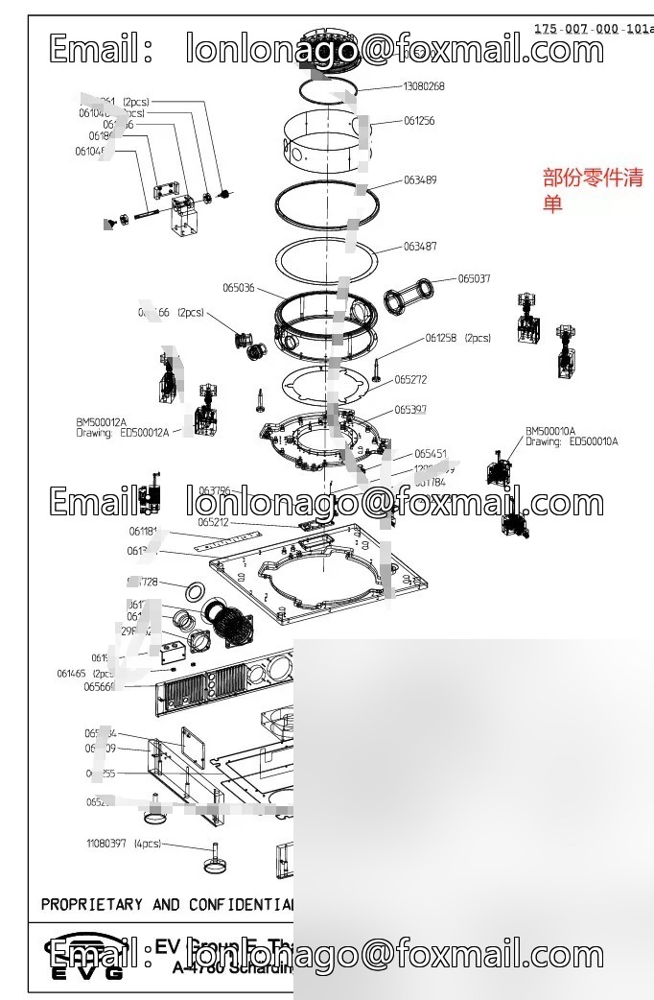
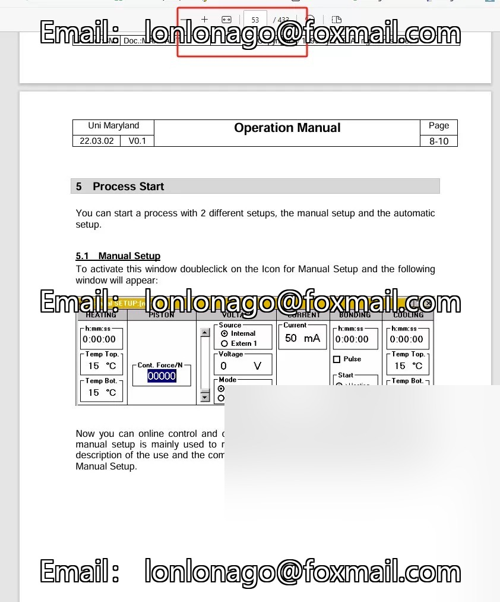
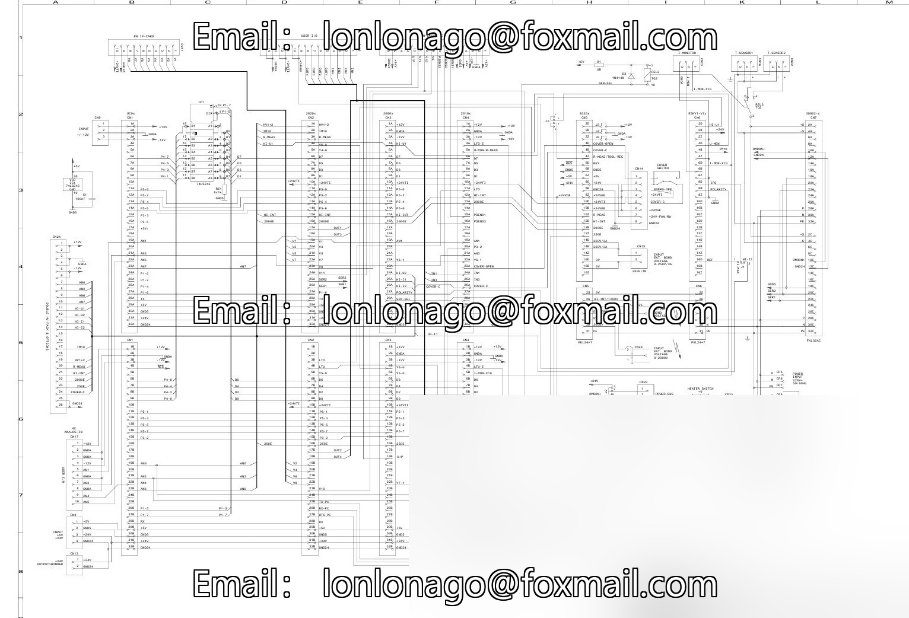
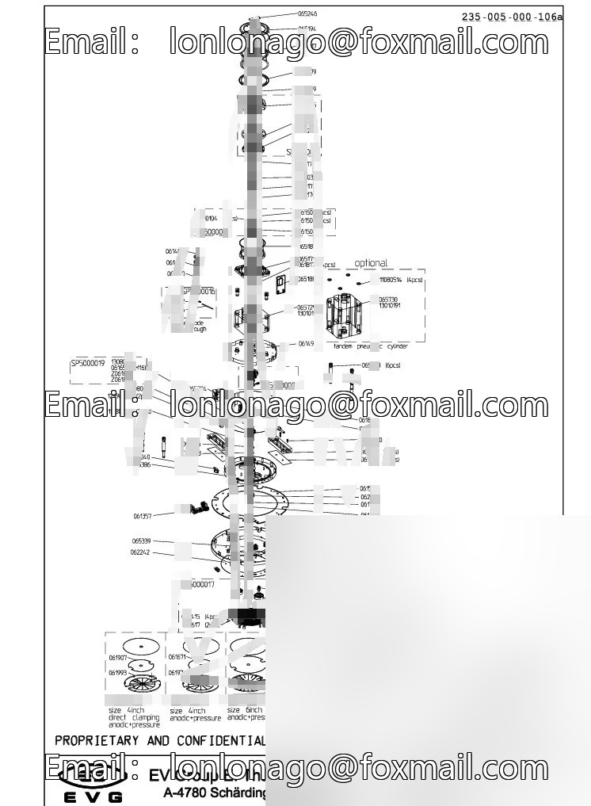
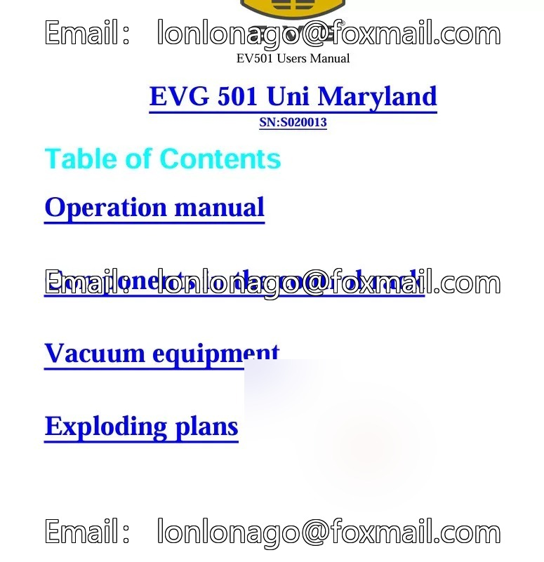
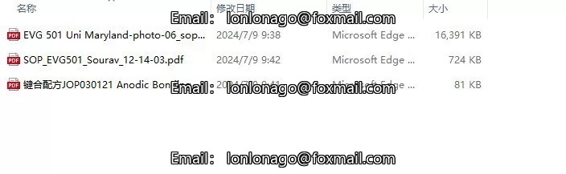

# EVG 501 wafer bonding machine manual materials, including some electrical drawings and parts

## Body

EVG 501 wafer bonding machine manual materials, including some electrical diagrams and part list

Take a photo and immediately send the electronic original file! The following images are screenshots of the file directory. Confirm before placing the order! Due to the replicability of electronic filing materials, So after purchase, returns are not allowed! Thanks for understanding!

The manual materials include partial electrical diagrams and part lists, along with directory screenshots, part and drawing information and operation instructions.

<!-- AI_ENRICHED -->

## Images

## Payment

Here is a pay link on Stripe ( https://buy.stripe.com/3cs8yP7sY87d0vu9AB ). Please contact me lonlonago@foxmail.com after funding $89, and I will send you a complete data files , thank you!

